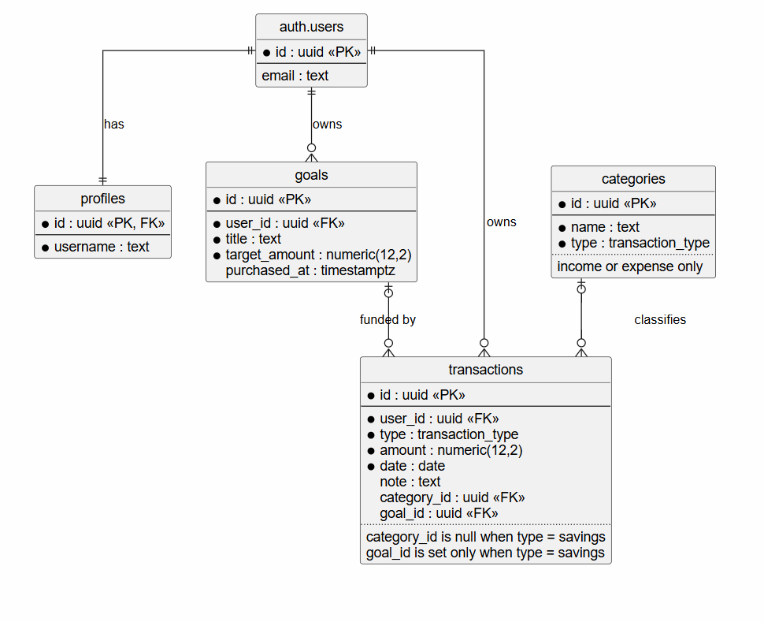

# Financial Dashboard

A personal financial dashboard for Tracking Incomes and Expenses and Savings toward user's goals.

## Data Modeling

The app uses [Supabase](https://supabase.com/) for both the database (PostgreSQL) and authentication.



### Tables

| Table | Purpose |
|---|---|
| `auth.users` | Managed by Supabase Auth. Stores email and the hashed password. |
| `profiles` | Extra user info (`username`, `image`). `id` references `auth.users(id)`. |
| `categories` | Fixed list of income and expense categories, shared by all users. |
| `goals` | Savings goals with a title and target amount. |
| `transactions` | Income, expense, and savings entries. |

### Business rules

- A transaction `type` is one of `income`, `expense`, or `savings`.
- **Income and expense** transactions must have a category and must not have a goal.
- **Savings** transactions must have a goal and must not have a category.
- A category must match the transaction type (for example, "Salary" can't be used on an expense). This is enforced by a composite foreign key `(category_id, type)`.
- A transaction can only be linked to a goal owned by the same user, enforced by a composite foreign key `(goal_id, user_id)`.
- Amounts must be greater than zero.
- Goal progress is **calculated** from savings transactions (`sum(amount) / target_amount`), never stored.
- When a completed goal is "bought", an `expense` transaction is created and `goals.purchased_at` is set.

### Categories

- **Income:** Salary, Bonus, Petty Cash, Others
- **Expense:** Transport, Beauty, Social Life, Education, Food, Health, Gift, Others
- **Savings:** no category

### Authentication

Users sign in with email and password through Supabase Auth, and passwords are never stored in the app's own tables. A database trigger creates a `profiles` row whenever a new user signs up. Logged-in users can change their password from the profile page using `supabase.auth.updateUser`.

```sql
create function public.handle_new_user()
returns trigger
language plpgsql
security definer set search_path = ''
as $$
begin
  insert into public.profiles (id, username)
  values (new.id, new.raw_user_meta_data ->> 'username');
  return new;
end;
$$;

create trigger on_auth_user_created
  after insert on auth.users
  for each row execute function public.handle_new_user();
```

### Row Level Security (RLS)

RLS is enabled on every table, so users can only access their own data, even if the app code has a bug.

```sql
alter table profiles     enable row level security;
alter table categories   enable row level security;
alter table goals        enable row level security;
alter table transactions enable row level security;

-- profiles: read and update own profile
create policy "Read own profile" on profiles
  for select to authenticated using ((select auth.uid()) = id);
create policy "Update own profile" on profiles
  for update to authenticated
  using ((select auth.uid()) = id) with check ((select auth.uid()) = id);

-- categories: read-only for all logged-in users
create policy "Read categories" on categories
  for select to authenticated using (true);

-- goals: full access to own goals
create policy "Manage own goals" on goals
  for all to authenticated
  using ((select auth.uid()) = user_id)
  with check ((select auth.uid()) = user_id);

-- transactions: full access to own transactions
create policy "Manage own transactions" on transactions
  for all to authenticated
  using ((select auth.uid()) = user_id)
  with check ((select auth.uid()) = user_id);
```